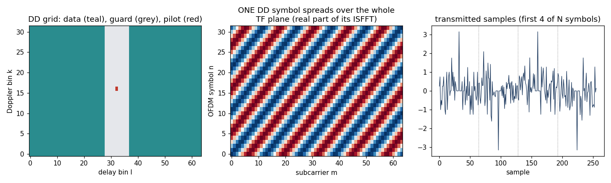
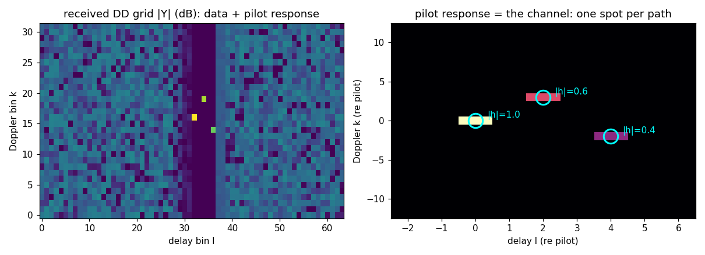
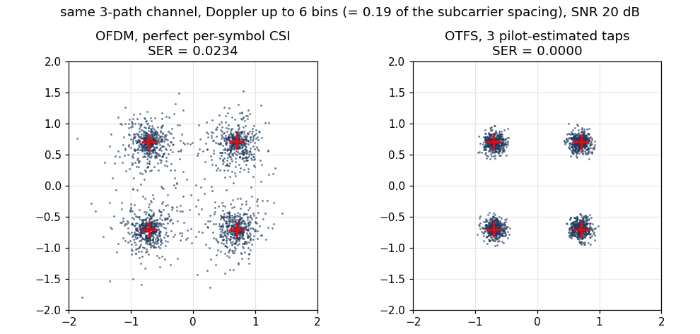
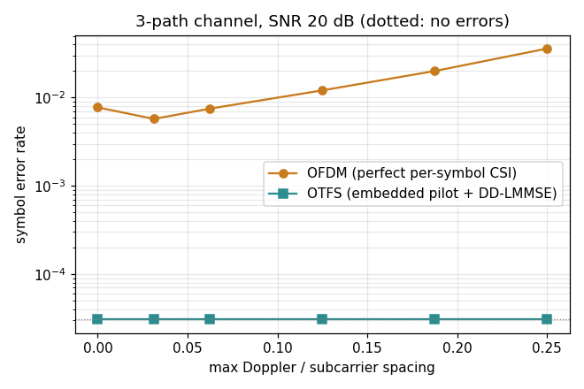
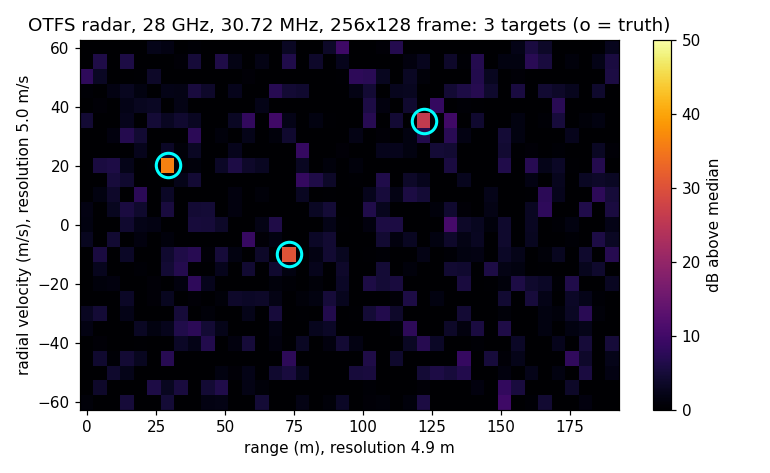

# RF-Stream-PHY

**RF-Stream-PHY** is an open research framework for building modern wireless-communication physical layers from scratch using software-defined radios and Python-based ML tools (NumPy, SciPy, PyTorch). The project is designed for researchers, students, and engineers who want to prototype, analyze, and improve communication PHY systems in a flexible software environment, while also connecting those designs to **real hardware experiments**. Instead of treating the physical layer as a fixed black box, RF-Stream-PHY treats it as a programmable, learnable, and data-driven system.

## Subprojects

The repository is organised around three research subprojects:

| Folder | Paper | Focus |
|---|---|---|
| [`AutoDataPHY/`](./AutoDataPHY/) | *Automated Data Collection and Annotation for Deep Learning-Aided Packet Detection* — **IEEE GLOBECOM 2026** | End-to-end OFDM PHY in Python, self-supervised CRC-based labelling, two-stage neural packet gate |
| [`OTFS/`](./OTFS/) | *Open Python/PyTorch OTFS-LDPC on PlutoSDR: Hardware-Validated Doppler Injection and Monostatic ISAC Loopback* — **IEEE MILCOM 2026** | OTFS PHY with 5G NR LDPC outer coding on commodity PlutoSDR; phase-continuous synthetic Doppler injection; **single-Pluto monostatic loopback** that eliminates LO drift (554× CFO reduction) and a hand-wave motion test that boosts OTFS decode from 0 % → 45 % on the same channel |
| [`MT-ATTN/`](./MT-ATTN/) | *Multi-Task Preamble Intelligence: Joint Packet Detection, Modulation Classification, and SNR Estimation with Phase-Rotation Augmentation for OTA Generalisation* — manuscript | Multi-task neural receiver (gate + mod + SNR) with temporal self-attention and phase-rotation augmentation for OTA generalisation |

New to OTFS? Start with the [OTFS tutorial](#tutorial-otfs-from-scratch--communication-and-radar) below.

`AutoDataPHY` builds the PHY, collects the data, and trains the packet gate.  `MT-ATTN` consumes the same captures to train a unified multi-task model that runs in 0.25 ms on Jetson Orin TRT.  `OTFS` extends the framework to a delay-Doppler waveform and adds infrastructure for controlled-Doppler mobility validation (synthetic injection + monostatic loopback).

## Open-Source Dataset and Models

The full dataset of **17,469 raw IQ captures** (31 GB) and **8 pretrained model checkpoints** (with ONNX exports) collected across both papers are published on the HuggingFace Hub:

| Resource | URL | Size |
|---|---|---|
| **OFDM dataset** | [`lkk688/ofdm-preamble-intelligence`](https://huggingface.co/datasets/lkk688/ofdm-preamble-intelligence) | 31 GB (17,469 NPZ) |
| **OFDM pretrained models** | [`lkk688/mt-preamcnn`](https://huggingface.co/lkk688/mt-preamcnn) | 20 MB (8 .pt + 2 ONNX) |
| **OTFS dataset** | [`lkk688/rf-stream-otfs`](https://huggingface.co/datasets/lkk688/rf-stream-otfs) | 3.0 GB (4,228 NPZ across 7 splits: closed-grid, OTA Doppler, monostatic) |

The dataset spans two RF domains:

- **CoaxSweep** (cable testbed, 4 splits, 8,605 NPZ, ~15 GB) — controlled SNR / gain sweep used to develop the PHY and train the baseline gate.
- **AirLink** (over-the-air at 2400 MHz, 4 splits, 8,864 NPZ, ~16 GB) — live OTA captures in a 2.4 GHz WiFi-congested environment, used to study and solve the **modulation-collapse domain-shift problem** addressed in the MT-ATTN paper.

See [`DATASET.md`](./DATASET.md) for the full dataset card (file format, labelling convention, sub-split breakdown, and code snippets for loading).

A single utility for uploading new captures back to the HuggingFace Hub is in [`upload_to_hf.py`](./upload_to_hf.py).

## Headline Result (MT-ATTN)

The best model — **MT-PreamCNN-Attn** trained with mixed CoaxSweep + AirLink data and phase-rotation augmentation — reaches:

- **100 %** CoaxSweep modulation accuracy
- **92.3 %** AirLink modulation accuracy (vs. 48.9 % zero-shot baseline)
- **0.82 dB** CoaxSweep SNR RMSE, **1.37 dB** AirLink SNR RMSE
- **0.985** AirLink gate AUC
- **0.25 ms** per-packet latency on Jetson Orin (TensorRT FP16)

at only **428 K parameters**.

## Vision

RF-Stream-PHY aims to make PHY-layer communication research more open, reproducible, and extensible by combining:

- **Classical communication system design** — synchronization, channel estimation, equalization, modulation, coding, packet detection
- **Modern scientific computing in Python** — NumPy, SciPy, matplotlib, Jupyter for fast iteration and visualization
- **Deep learning and differentiable modeling** — PyTorch for neural receivers, learned demappers, signal detectors, hardware-adaptive models
- **Hardware-in-the-loop experimentation** — SDR platforms to bridge simulation and real radio deployment

## Design Philosophy

This project is built around four core ideas:

### 1. PHY should be programmable
Modern communication research benefits from software-first design. Building PHY blocks in Python and PyTorch lets us iterate faster, inspect intermediate signals, and connect classical algorithms with machine learning.

### 2. Real hardware matters
Simulation is valuable, but real-world RF behavior often differs from idealized channel models. RF-Stream-PHY is designed for hardware-in-the-loop workflows so that models and algorithms can be evaluated under realistic conditions.

### 3. Data collection should be part of the PHY workflow
A modern PHY system should not only transmit and receive packets, but also generate useful research datasets. Logging, labelling, metadata collection, and hard-negative mining are treated as first-class capabilities (see AutoDataPHY).

### 4. Learning should augment, not replace, the PHY
The project supports both classical DSP pipelines and neural components. This allows direct comparison, hybrid designs, and gradual integration of learned modules where they add practical value (see MT-ATTN).

## Intended Use Cases

RF-Stream-PHY is suitable for:

- Communication systems research
- SDR-based prototyping
- Deep learning for wireless PHY
- Dataset generation for RF ML
- Classroom and lab instruction
- Rapid experimentation with new receiver ideas
- Reproducible hardware-in-the-loop evaluation

## Hardware Used

- **TX:** NVIDIA Jetson Orin + ADALM-PlutoSDR (USB) — runs `rf_stream_tx_step6phy.py`
- **RX:** x86 Ubuntu host + ADALM-PlutoSDR (USB) — runs `rf_stream_rx_step{8,9,10}phy.py`
- **Carrier:** 2400 MHz, 3 MHz sample rate, 64-FFT OFDM with CP=16
- **Inference deployment:** NVIDIA Jetson Orin (CUDA 12.6, TensorRT 10.3)

## Quick Start

```bash
git clone https://github.com/<your-org>/RF-Stream-PHY.git
cd RF-Stream-PHY

# Install minimal Python dependencies
pip install numpy scipy torch scikit-learn matplotlib onnxruntime huggingface_hub

# Subproject 1: build the PHY and collect data
cd AutoDataPHY && cat README.md

# Subproject 2: train the multi-task neural receiver
cd ../MT-ATTN && cat README.md

# Or download the published dataset (~31 GB) for offline experiments
python3 -c "
from huggingface_hub import snapshot_download
snapshot_download('lkk688/ofdm-preamble-intelligence', repo_type='dataset',
                   local_dir='./data')
"
```

For a guided walkthrough — data loading, training, evaluation, ONNX/TensorRT deployment, and full paper reproduction — see [`MT-ATTN/TUTORIAL.md`](./MT-ATTN/TUTORIAL.md).

## Tutorial: OTFS from scratch — communication and radar

This is a short, teaching-level walk through OTFS (Orthogonal Time Frequency Space): what it is, how it
differs from OFDM, and how one transmitted frame serves both **communication** and **radar**. All code below
comes from one self-contained script (NumPy + Matplotlib, about 40 s on a laptop) that also draws every figure:

```bash
python3 OTFS/tutorial/otfs_tutorial.py      # writes OTFS/tutorial/figs/fig1..fig5
```

The hardware receiver in [`OTFS/otfs/`](./OTFS/otfs/) adds what a real radio needs (preamble sync, CFO
correction, LDPC, PlutoSDR I/O). The tutorial leaves these out so that only the ideas remain.

### 1. The idea: describe the channel by *delay* and *Doppler*

A wireless channel is a handful of reflectors. Each reflector is described by two numbers:
- a **delay** τ, set by its distance;
- a **Doppler shift** ν, set by its relative speed.

OFDM works on the **time–frequency (TF)** grid of subcarrier × symbol. On that grid the same channel looks
busy: it fades across frequency (multipath), and under mobility it also changes from symbol to symbol (Doppler).

OTFS puts the data on the **delay–Doppler (DD)** grid instead: M delay bins × N Doppler bins. There the
channel is just a few spots, one per reflector, and it stays the same for the whole frame.

| Grid step | Formula | Meaning |
|---|---|---|
| Delay resolution | 1/(MΔf) | one sample period |
| Doppler resolution | 1/(NT) | one over the frame length |

The modulator is an ordinary OFDM modulator with a 2-D transform in front of it:

```python
def isfft(X):                      # DD grid (M delay x N Doppler) -> TF grid (M subcarriers x N symbols)
    M, N = X.shape
    return np.fft.fft(np.fft.ifft(X, axis=1), axis=0) * np.sqrt(N / M)

def otfs_mod(X):                   # ISFFT, then IFFT per symbol (an OFDM modulator); one CP for the frame
    M, N = X.shape
    s_tf = np.fft.ifft(isfft(X), axis=0) * np.sqrt(M)
    return s_tf.reshape(-1, order="F")

def otfs_demod(r, M, N):           # FFT per symbol, then SFFT (the inverse of ISFFT)
    R = r.reshape(M, N, order="F")
    return sfft(np.fft.fft(R, axis=0) / np.sqrt(M))
```



The middle panel shows the key property: **one DD symbol covers the entire TF plane**. Every data symbol
therefore experiences all the frequency fading and all the time variation of the channel, and is averaged over
them. This is the full time-frequency diversity that OTFS is known for.

### 2. OFDM vs OTFS at a glance

| | OFDM | OTFS |
|---|---|---|
| Where symbols live | TF grid: subcarrier × OFDM symbol | DD grid: delay × Doppler |
| What one symbol sees | One complex gain on its subcarrier, which drifts over time under Doppler | All paths, as a few shifted copies: a 2-D convolution over the DD grid |
| Effect of Doppler | Inter-carrier interference (ICI) and time variation, so pilots must be dense or tracked | A shift along the Doppler axis: resolved, not interference |
| Pilots | Scattered or comb pilots over the TF grid | One embedded pilot plus a guard region |
| Equalizer | One tap per subcarrier (cheap) | DD-domain equalizer: LMMSE or message passing (costlier) |
| Cyclic prefix | One per OFDM symbol | One per frame (or per block) |
| Radar view | Range–Doppler after TF processing | The DD grid *is* the range–velocity grid |

### 3. Communication, step by step

**Step 1: build a frame.** Place QPSK data on the DD grid with one strong pilot. Around the pilot, leave a
guard band of empty delay rows, as wide as the largest delay spread (grey region in Fig. 1, left).

```python
mask = np.ones((M, N), bool)                                   # True = data cell
mask[np.arange(lp - lmax, lp + lmax + 1) % M, :] = False        # guard rows, all Doppler bins
X[mask] = QPSK[sym];  X[lp, kp] = pilot                         # data + pilot
```

**Step 2: the channel.** Each path delays the signal by l samples and rotates it by its Doppler. The frame CP
makes the delay cyclic.

```python
def channel(s, paths):             # paths: [(gain h, delay l, Doppler k), ...]
    MN = s.size;  n = np.arange(MN)
    return sum(h * np.roll(s, l) * np.exp(2j * np.pi * k * n / MN) for h, l, k in paths)
```

**Step 3: receive and read the channel.** After `otfs_demod`, the pilot reappears once per path, at
(pilot delay + l, pilot Doppler + k). Channel estimation is just reading those cells: any cell 3σ above the
noise counts as a tap, and the gain is the reading divided by the pilot.



**Step 4: equalize.** The DD channel is linear, y = H x + w. The tutorial builds H from the estimated taps by
sending a unit symbol through each cell, then solves an LMMSE problem for the data cells.

```python
Hd = H[:, data_cells]
x_hat = np.linalg.solve(Hd.conj().T @ Hd + noise_var * np.eye(Hd.shape[1]), Hd.conj().T @ (y - H @ x_pilot))
```

This dense solve costs O((MN)³), which is fine for teaching. Real receivers use the sparsity of H instead
(message passing, conjugate gradients). That cost is why the OTFS receiver is slower than OFDM's one-tap
equalizer on the Jetson.

**Step 5: compare with OFDM under the same channel.** The setup:
- 3 paths with delays 0, 2 and 4 samples, and Doppler 0 and ±k bins;
- 20 dB SNR, uncoded QPSK;
- OFDM is given **perfect per-symbol channel knowledge** (its best case);
- OTFS uses only its own pilot.





**Why the curves differ:**
- **OFDM:** Doppler spreads each subcarrier into its neighbours (ICI), which no one-tap equalizer can undo.
  Its symbol error rate grows with Doppler, from 0.8% (static) to 3.6% at a Doppler of a quarter subcarrier
  spacing.
- **OTFS:** Doppler only moves the channel spots along the Doppler axis, and the DD equalizer separates them;
  there are no errors at any Doppler.
- **At zero Doppler:** OTFS still wins, because every symbol is spread over all subcarriers (diversity), while
  an OFDM symbol on a faded subcarrier is simply lost.

**Fairness notes:**
- **OTFS cost:** the guard band takes 14% of the cells, and the pilot carries extra energy.
- **Coding:** with LDPC coding, as in the hardware stack, OFDM recovers much of the static-channel diversity
  loss, but not the Doppler loss.

### 4. Radar with the same frame

A monostatic ISAC transmitter knows every symbol it sent, so radar needs no pilot. Correlating the echo with
the transmitted frame at each delay, then taking an FFT over time, gives the **range–Doppler map**. It lands on
the same DD grid:
- range = c·l/(2MΔf);
- velocity = λ·k/(2NT).

```python
rd = np.array([np.fft.fftshift(np.fft.fft(r * np.conj(np.roll(s, l)))) for l in range(n_range_bins)])
```



In this example (28 GHz, Δf = 120 kHz, 256 × 128 frame):

| Quantity | Value |
|---|---|
| Range resolution | 4.9 m |
| Velocity resolution | 5.0 m/s |
| Matched-filter gain | 45 dB, so all three targets stand clear even at −10 dB SNR per sample |

The resolution follows two rules:
- **Range resolution** improves only with bandwidth (MΔf).
- **Velocity resolution** improves only with frame duration (NT) and carrier frequency.

Real radars also cancel the strong static echoes (clutter) before detection and use CFAR thresholds to
decide what counts as a target.

### 5. Where to go next
- **Full hardware chain:** [`OTFS/README.md`](./OTFS/README.md) covers sync, embedded-pilot DD-LMMSE,
  LDPC, and PlutoSDR scripts.
- **No-radio experiment:** the software Doppler sweep runs OTFS vs OFDM with LDPC; see
  `OTFS/doppler_sweep_loopback.py`.
- **Captures:** the released OTA captures are listed in [Open-Source Dataset and Models](#open-source-dataset-and-models).

## Status

RF-Stream-PHY is an active research-oriented project under development. The repository will continue to expand with:

- Reusable PHY modules
- Experiment scripts
- Dataset tools
- Training pipelines
- Hardware integration examples
- Documentation for reproducible research workflows

## Contributing

Contributions, discussions, and collaboration are welcome. This project is intended to grow into an open platform for communication PHY research, real-radio experimentation, and learning-based wireless system design.

## Citation

If you use this project in research, please cite:

```bibtex
@inproceedings{liu2026otfs,
  title     = {Open {Python/PyTorch} {OTFS-LDPC} on {PlutoSDR}: Hardware-Validated
               {Doppler} Injection and Monostatic {ISAC} Loopback},
  author    = {Liu, Kaikai},
  booktitle = {Proc. IEEE Military Communications Conference (MILCOM)},
  year      = {2026}
}

@inproceedings{liu2026autodataphy,
  title     = {Automated Data Collection and Annotation for Deep Learning-Aided
               Packet Detection},
  author    = {Liu, Nairui and Zhou, Miaosen and Liu, Kaikai},
  booktitle = {Proc. IEEE Global Communications Conference (GLOBECOM)},
  year      = {2026}
}
```

The MT-ATTN subproject is described in a manuscript that is not yet published; please cite the
repository for it until then.

## License

Code: MIT License (see [`LICENSE`](./LICENSE))
Dataset: [CC BY 4.0](https://creativecommons.org/licenses/by/4.0/)
